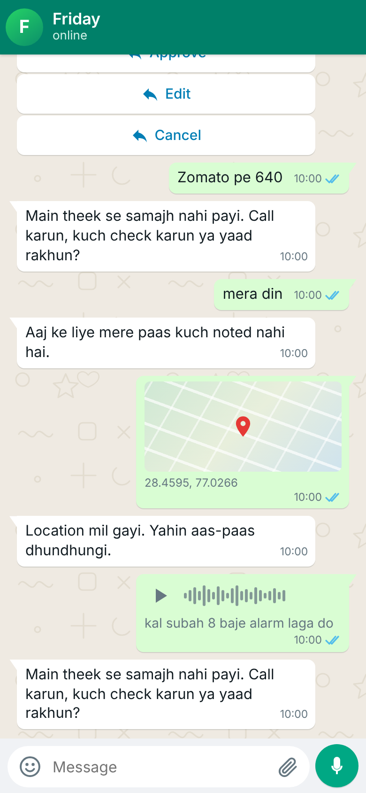
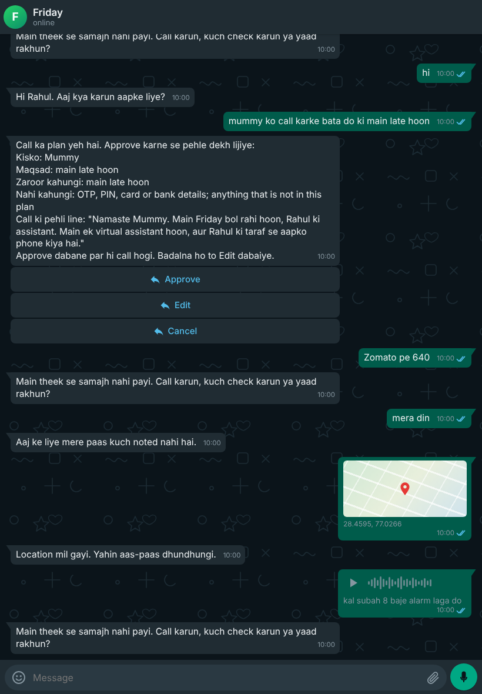

# Friday Chat Lab (22 Oct 2026)

A WhatsApp-style page you open in a browser to test the chatbot **without WhatsApp**. You type, Friday answers with bubbles, buttons and
lists. The default link shows **only the chat** (looks and feels like WhatsApp, nothing else on the screen); the developer tools (side panel,
switches, fake clock, user switcher) are behind `?dev=1`. It is a test tool: the dev labels are not product copy.

 
(more in `docs/img/chatlab/`: iPad light, phone dark, the attach sheet.)

## Default view vs developer view

- **Default** (`https://<host>/lab/<token>/`): green header (dark in dark mode) with avatar, "Friday" and "online" / "typing...", wallpaper, your
  green bubbles on the right and Friday's on the left with tails, time, ticks (one sent, two delivered, blue read), day separators (Today /
  Yesterday), WhatsApp-style reply buttons and list sheet, an emoji tray, and an input bar whose round button is a mic when empty and send
  when you type. The clip opens Document (browse, or a named sample such as `electricity-bill.pdf`), Photos, Location (Gurgaon, Bangalore,
  Mumbai) and Contact (invented people). Light/dark follows the device; safe areas and 16 px inputs for iPad and phone. No banners, notes,
  hints, chips, switches or panel are even sent to the browser.
- **Developer** (`...?dev=1`, or tap the header title 5 times, which reloads with `?dev=1`): adds the SIMULATOR line, a gear for the side panel
  (Controls: user picker, New user, Reset chat, fake clock, callee, exports, theme, quick messages, custom pin/contact; Turn, User, Switches
  incl. the real-model toggle, Raw), "mark wrong" under Friday's bubbles, button ids, template tags, the wording-pending list. Same API, same
  token, same simulator-only rules. The server strips the dev parts from the page unless `dev=1` is in the link.

The sections below describe the developer view's panel and controls; in the default view none of those exist.

Code: `friday/lab/` (page: `friday/lab/static/index.html`, one file, no CDN). Tests: `tests/lab/`. Start it with `friday lab`.

## It never talks to real WhatsApp

- It runs in **simulator mode only**: an in-memory chat (the same `SimulatorChannel` that `friday chat` uses), fake text messages, fake
  telephony, an in-memory database that is gone when you stop it.
- It **does not read `.env`** and ignores provider keys in the environment (WhatsApp, SMS, voice, Google Places and so on are pinned to
  their simulators and their keys are blanked inside the lab). A test asserts the lab has no live channel configured.
- It **refuses to start** when `FRIDAY_MODE=live` is set in the environment. A separate flag `--allow-live-env` lets it start anyway, and
  even then it builds the same simulator world. This is on purpose: you can run it on the server without fear.
- It only accepts **invented phone numbers** (`+91 9800 ......` for users, `+91 9000 ......` for people Friday calls). Anything else is
  refused, so a real number cannot get in even by mistake.
- Access: it listens on `127.0.0.1` only by default. Every page and every API call needs the **secret token** it prints at start, and the
  token **expires after 8 hours** (`--ttl-hours`). Wrong or expired token: a plain 404, no hint.

## Three ways to run it

### 1. On your own computer

```
uv run friday lab
```

It prints a link like `http://127.0.0.1:8766/lab/<token>/`. Open it in a browser on the same computer. Stop with ctrl-c.
Options: `--port`, `--ttl-hours`, `--notes` (where "mark wrong" notes go), `--public-url`, `--host` (a non-local address is allowed but prints a
warning: anyone with the link could then use the lab).

### 2. On the server (from your iPad)

On the server, inside tmux so it keeps running:

```
tmux new -s lab
sudo bash /opt/friday/deploy/chat-lab.sh
```

It runs the lab as the `friday` user, simulator mode, on `127.0.0.1:8766`, and prints the link with the token. Detach with ctrl-b d, come back
with `tmux attach -t lab`, stop with ctrl-c.

To open it from the iPad over HTTPS, add the Caddy route once (same idea as `deploy/explore-https.sh`, but separate and only for `/lab`):

```
sudo bash /opt/friday/deploy/lab-https.sh          # add the /lab/* route to Caddy
sudo bash /opt/friday/deploy/lab-https.sh --off    # remove it again
```

The route forwards only `/lab/*` to `127.0.0.1:8766`; the front door stays on 8000. If you also use `explore-https.sh`, run that one first (it
rewrites the whole Caddyfile) and `lab-https.sh` second (it keeps the `/explore` route). With the route in place `chat-lab.sh` prints the
`https://<your-host>/lab/<token>/` link by itself; you can also pass `--public-url https://<your-host>`.
Two honest limits: the token is part of the address, so it also shows up in Caddy's access log (do not share that log), and when the lab is
not running Caddy answers 502 on `/lab`.

### 3. From the Claude Code web sandbox: not reachable from the iPad

The sandbox's ports are not on the internet, so an iPad cannot open the lab from there. Use way 1 or 2. (Tests and the screenshots we took of
the page run inside the sandbox; that is not the same as you using it.)

## What is real and what is fake

| Part | Real or fake |
|---|---|
| The pipeline: front door, onboarding, consumer router (calls, savings, your day), call gate and approval, task engine, proactive engine, reply wording | **Real code** (the same classes the server runs) |
| WhatsApp itself: delivery, templates approved by Meta, the 24-hour window with a real phone | **Fake** (in-memory channel; ticks are drawn by the lab, WhatsApp is not asked) |
| The language model | **Fake by default** (deterministic, free). A switch uses the real model **only if a key exists in the environment**, is labelled "COSTS MONEY", and is off by default. Even with it on, nothing is sent to anyone |
| The calls | **Fake**: when you approve a call, a simulated person answers (see "Callee" below), there is no phone line and no audio |
| The clock | **Fake**: starts at 10:00 IST today; only moves when you press "+1 hour" or "Next morning" |
| The database | In memory, empty at start (plus the three saved test users); gone on stop |
| Speech to text | **Stand-in**: a voice note is read as the words you type for it |
| Card rules | The repo's **invented EXAMPLE rows** (not real offers) |
| Google connect | Off (needs a Google Cloud project) |
| Numbers | Invented only |

## The page

**Chat.** Your messages are on the right with ticks (one tick sent, two delivered, blue read: drawn by the lab), Friday's on the left with the
time of the fake clock. Reply buttons (up to three) are real buttons; each shows its id underneath (for example `callap:...:approve:...`) so you can see
what Friday will receive. List messages open a picker (the page and API support it; Friday's code does not send list messages yet, see "Not verified").
Typing `1`, `2` or `3` taps that button of Friday's last message, like `friday chat`. Tap one of Friday's bubbles to see that turn in the side panel.
A small "mark wrong" link under each Friday bubble stores a note (see "Controls").

**Composer.** Text. A round dot button for a **voice note**: it can record from the microphone if the browser allows (the clip is only played back
in the chat), and you always type "what the voice note says" (that is what Friday's fake speech-to-text uses; on Safari the browser may fill it in for
you). The **+** button opens **Attach**: a location pin (type latitude and longitude, or pick Gurgaon, Bangalore, Mumbai), a contact card (invented
people, or type a name and an invented number), an image or PDF (pick a file from the device, up to 5 MB, or a named sample such as
`electricity-bill.pdf`).

**Quick chips** above the composer: `hi (first run)`, `mummy ko call`, `cards`, `Zomato pe 640`, `interview kal`, `mera din`, `menu`, `delete everything`,
and a second row in Devanagari (`कल 2 बजे interview है`, `मम्मी को कॉल करके बता दो`, `मेरा दिन`). For the first-run onboarding use **New user** and then `hi`.

## The side panel ("Inside")

Open by default on wide screens; on an iPad in portrait or a phone it is a full-screen sheet behind the **Inside** button.

- **Turn**: for the selected turn (the last one by default):
  - *Route*: which handler answered (for example "call request", "life capture", "which card to use", "onboarding", "brain, intent X"), whether
    **rules or the language model** answered, and every step that ran in order. The classifier line says it is not used on the chat path (the trained
    classifier works on voice calls only).
  - *Understood*: the intent, confidence and slots from the brain, or the parsed call request / purchase / life statement from the consumer rules.
  - *Guards*: each decision with its reason codes: the call gate (allow / deny / ask, for example `ok`, `dnc`, `outside_window`), the inbound throttle,
    the secret/card check.
  - *Latency*: real milliseconds in total and per stage, and model calls.
  - *Wording still pending your approval*: the copy keys used in this turn from modules marked PENDING_FOUNDER_APPROVAL (calls, savings, life state,
    the integration lines, Google consent). Older flows (onboarding, quotes) use wording that is not tracked this way.
  - *Simulated call*: the outcome, summary and the transcript of the pretend call when a call ran in this turn.
- **User**: the test user's state: account status, onboarding step, consent, PIN set (yes/no, never the PIN), language, tone, name **masked**, city,
  morning brief on/off, 24-hour window, contacts, noted events, and anything Friday sent to other people (simulated).
- **Switches**: live toggles for **this session only**: the four consumer switches (calls, savings, lifestate; Google is off) and the four latency
  switches (they change the voice-call path only, so they will not change chat replies), plus the real-language-model toggle.
- **Raw**: the whole JSON of the turn.

## Controls (top bar)

- **User** picker: three saved test users: *Rahul* (Hinglish, contacts Mummy, Papa, Didi, morning brief on), *Priya* (English, one contact, no morning
  brief), *Sunita* (Hindi in Devanagari, morning brief on). All invented. **New user** makes a fresh invented number with an empty account, so the
  next message starts the real onboarding.
- **Reset chat**: clears this user's chat and pending questions (the account stays; use New user for a clean start).
- **Fake clock**: **+1 hour**, and **Next morning** (jumps to 08:10 the next day). After the jump the lab runs what the server would have run: the
  proactive engine, the periodic jobs and the job queue. So the morning brief, follow-ups and bill reminders appear in the chat. The brief goes only to users who
  opted in (Rahul and Sunita).
- **Callee**: who answers when Friday calls: friendly elder, busy (gives a time), hostile, wrong number, voicemail, "are you a bot?". Pick one, ask for
  a call (`mummy ko call karke bata do ki main late hoon`), tap Approve, and the call report arrives in the chat with its transcript in the panel.
- **Export .md / .json**: real download links (served by the app, not a browser blob) with the whole chat and the panel data of every turn.
- **mark wrong** (under a Friday bubble): saves your note, the input, the reply, the route and the intent as one JSON line in `var/lab/notes.jsonl`
  (ignored by git; on the server `/opt/friday/var/lab/notes.jsonl`). It is for labelling later; nothing is learned from it automatically.
- **Theme**: light or dark (follows the device until you press it). The page works on iPad and phone.

## Not verified / known limits

- The page was checked in a headless Chromium (wide, iPad and phone sizes, light and dark) and its script passes a syntax check, but **not on a real iPad or
  with a real microphone**. Voice recording, the browser speech hint and file picking on iOS are unchecked.
- **List messages**: the lab shows them as a picker if Friday sends one, but Friday's outbound message model has no list type yet, so no real flow
  produces one today. The picker is covered by a unit test with a stand-in message.
- The "wording pending approval" list covers the five copy modules that carry the PENDING marker, not the older onboarding or quotes wording.
- Session switches flip the consumer router's parts; a button already shown in the chat from a switched-off part may still answer. The real server
  restarts to change a switch.
- The real-language-model switch is untested against a real key (no key here).
- Everything uses invented numbers and EXAMPLE card rows; replies only show what the code does, not how real WhatsApp renders it.
